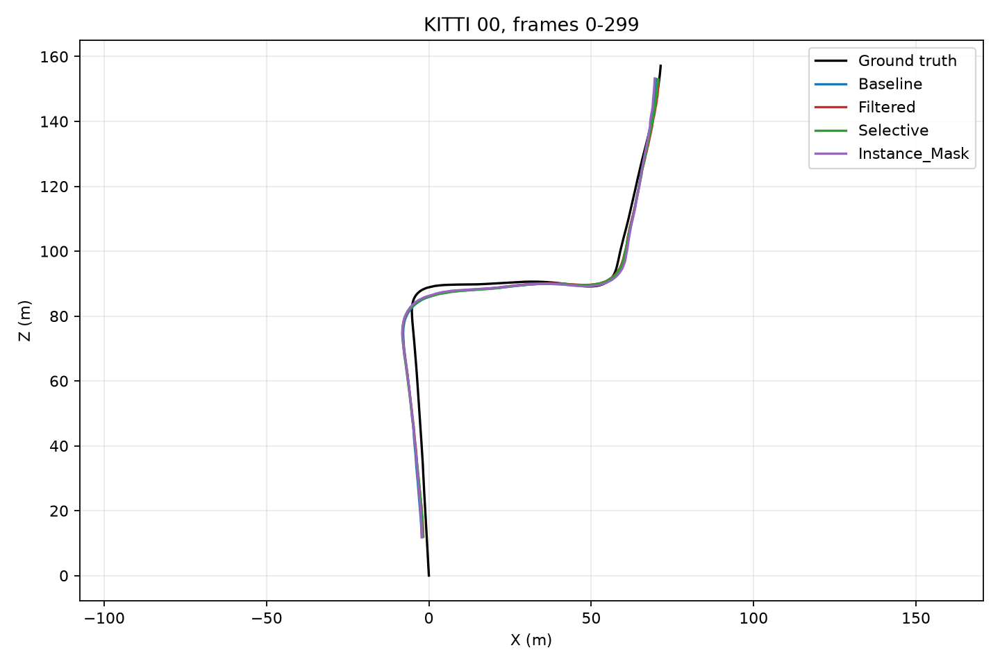
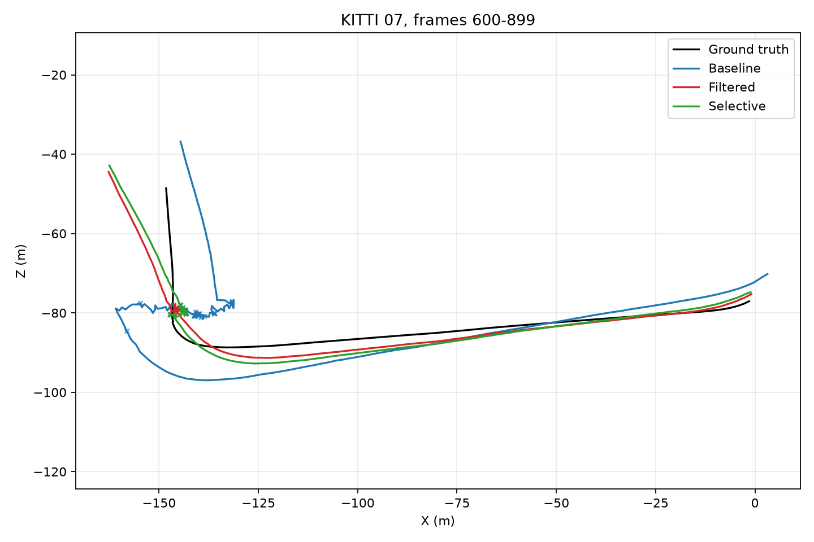
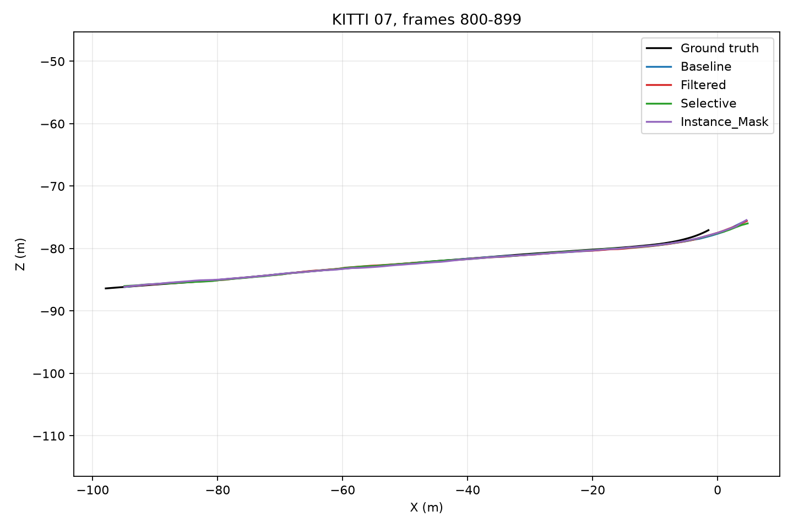
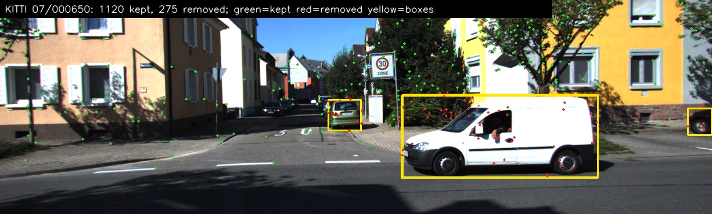

# Initial VO results and failure analysis

Run: `python -m rvo.run` with `configs/kitti_mvp.toml`, KITTI left and right color cameras, YOLO11n and YOLO11n-seg, NVIDIA GeForce RTX 4070 Ti. These are exploratory windows, not a broad KITTI benchmark. ATE uses one Sim(3) fit per variant on poses valid in all seven variants. All-frame ATE uses every frame, including the carried pose at a failed estimate. RPE uses 10-frame intervals with endpoints valid in all variants.

| Sequence / frames | Method | Common-pose ATE (m) | All-frame ATE (m) | Pose failures | Mean time (ms/frame) |
| --- | --- | ---: | ---: | ---: | ---: |
| 00 / 0-299 | Baseline | 5.16 | 5.16 | 0 / 299 | 48.7 |
| 00 / 0-299 | Hard boxes | 5.11 | 5.11 | 0 / 299 | 63.3 |
| 00 / 0-299 | Selective flow gate | 5.14 | 5.14 | 0 / 299 | 64.1 |
| 00 / 0-299 | Instance masks | 5.06 | 5.06 | 0 / 299 | 66.3 |
| 00 / 0-299 | Temporal motion | 5.14 | 5.14 | 0 / 299 | 64.4 |
| 00 / 0-299 | Epipolar residual | 5.11 | 5.11 | 0 / 299 | 66.3 |
| 00 / 0-299 | Stereo residual | 5.10 | 5.10 | 0 / 299 | 181.7 |
| 07 / 600-899 | Baseline | 7.82 | 8.29 | 32 / 299 | 51.8 |
| 07 / 600-899 | Hard boxes | 6.99 | 5.93 | 91 / 299 | 64.9 |
| 07 / 600-899 | Selective flow gate | 7.30 | 6.16 | 84 / 299 | 66.0 |
| 07 / 600-899 | Instance masks | 7.01 | 5.80 | 81 / 299 | 68.0 |
| 07 / 600-899 | Temporal motion | 4.55 | 4.82 | 63 / 299 | 66.7 |
| 07 / 600-899 | Epipolar residual | 6.45 | 5.97 | 61 / 299 | 69.0 |
| 07 / 600-899 | Stereo residual | 8.38 | 6.95 | 87 / 299 | 181.4 |
| 07 / 800-899 | Baseline | 1.99 | 1.99 | 0 / 99 | 52.0 |
| 07 / 800-899 | Hard boxes | 1.99 | 1.99 | 0 / 99 | 65.7 |
| 07 / 800-899 | Selective flow gate | 2.00 | 2.00 | 0 / 99 | 66.7 |
| 07 / 800-899 | Instance masks | 1.99 | 1.99 | 0 / 99 | 68.8 |
| 07 / 800-899 | Temporal motion | 1.99 | 1.99 | 0 / 99 | 67.3 |
| 07 / 800-899 | Epipolar residual | 1.99 | 1.99 | 0 / 99 | 69.8 |
| 07 / 800-899 | Stereo residual | 1.99 | 1.99 | 0 / 99 | 183.2 |

The 600-899 ATE comparison uses 203 poses valid in all seven variants; the other windows use every pose. Temporal motion is the strongest result in this window: common-pose ATE is 4.55 m and all-frame ATE is 4.82 m, versus 7.82 m and 8.29 m for baseline. It still has 63 failed pose estimates, compared with 32 for baseline. It removed about 227 features per frame on average after object motion persisted for two frames. Epipolar residuals reduced failures to 61 and all-frame ATE to 5.97 m, but common-pose ATE was 6.45 m. Stereo residuals were worse than baseline on this window (8.38 m common-pose ATE, 87 failures) and cost about 179 ms/frame; dense disparity averaged about 102 ms/frame. On sequence 00 and the moving-camera slice, all methods are close in ATE. The selective flow gate has 60 low-motion degeneracy frames (`median retained flow <= 4 px` and RANSAC inlier ratio `>= 0.8`); those remain failures.

The main failure cluster occurs around frames 643-738. The median ground-truth step in the 640-740 interval is about 0.009 m, while many failed filtered frames still have hundreds of RANSAC inliers and fewer than eight `recoverPose` inliers. This supports a near-stationary/low-parallax explanation. Ground truth was used for this diagnosis and evaluation only, never for pose estimation. Calling the carried pose a new successful estimate would not change the trajectory, so the runner does not do that.

On the moving-camera slice, frames 800-899, all methods complete every pair and their ATE is effectively equal. Temporal and epipolar checks add about 14 ms/frame; stereo adds about 120 ms/frame. Stereo's first prototype needs tuning before it is useful. Timing includes image reads, Shi-Tomasi/Lucas-Kanade tracking, geometry, and model inference plus method-specific filtering; model loading and CUDA warmup are excluded.

## Visuals

Yellow boxes mark potentially moving objects; red points are removed by hard filtering. The white van crosses the camera view in sequence 07 frame 650.

